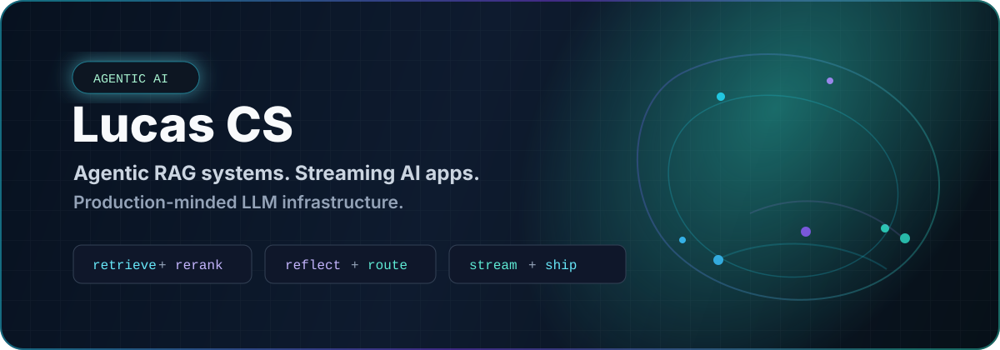
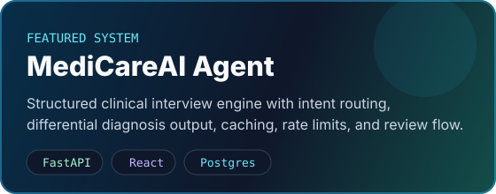
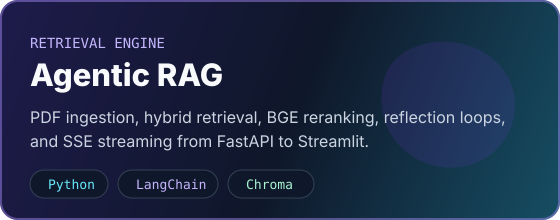
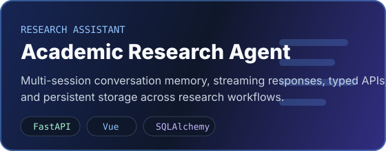
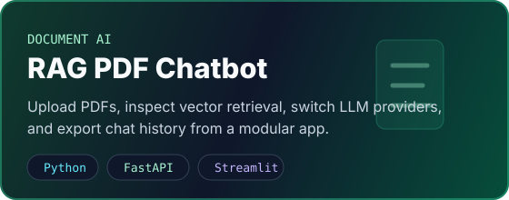

<p align="center">
  
</p>

<h1 align="center">Lucas CS</h1>

<p align="center">
  Building agentic AI systems, RAG products, and production-minded LLM infrastructure.
</p>

<p align="center">
  <a href="mailto:chengshuo.dai@yale.edu">Email</a>
  |
  <a href="https://www.linkedin.com/in/chengshuo-dai">LinkedIn</a>
  |
  <a href="https://github.com/chengshuo-dai">GitHub</a>
  |
  New Haven, CT
</p>

## Signal

```txt
Focus        Agentic RAG / multi-agent systems / applied LLM products
Strength     FastAPI backends, streaming UX, retrieval pipelines, structured outputs
Direction    From research prototypes to reliable user-facing AI systems
```

## Systems I Build

- **Agentic retrieval systems** with query rewriting, hybrid search, reranking, reflection loops, and transparent intermediate states.
- **Full-stack LLM products** with FastAPI, Streamlit, Vue, React, typed APIs, persistent sessions, and SSE streaming.
- **Production-minded AI infrastructure** with validation, caching, rate limits, observability, fallback paths, and deployment-ready architecture.

## Featured Builds

<table>
  <tr>
    <td width="50%">
      <a href="https://github.com/chengshuo-dai/medicare_agent">
        
      </a>
    </td>
    <td width="50%">
      <a href="https://github.com/chengshuo-dai/Agentic-RAG">
        
      </a>
    </td>
  </tr>
  <tr>
    <td width="50%">
      <a href="https://github.com/chengshuo-dai/Multi-Session-Academic-Research-Agent">
        
      </a>
    </td>
    <td width="50%">
      <a href="https://github.com/chengshuo-dai/RAG_PDF_Chatbot">
        
      </a>
    </td>
  </tr>
</table>

## Technical Stack

| Layer | Tools |
| --- | --- |
| AI / LLM | LangChain, RAG, embeddings, reranking, structured outputs, agent workflows |
| Backend | Python, FastAPI, Pydantic, SQLAlchemy, REST APIs, SSE |
| Frontend | TypeScript, JavaScript, React, Vue 3, Streamlit, Vite |
| Data / Infra | PostgreSQL, pgvector, Redis, ChromaDB, Docker |

## Current Focus

- Raising retrieval quality for multi-step reasoning workflows.
- Making agent behavior inspectable instead of hiding everything behind a final answer.
- Turning useful prototypes into systems with real product and reliability constraints.
